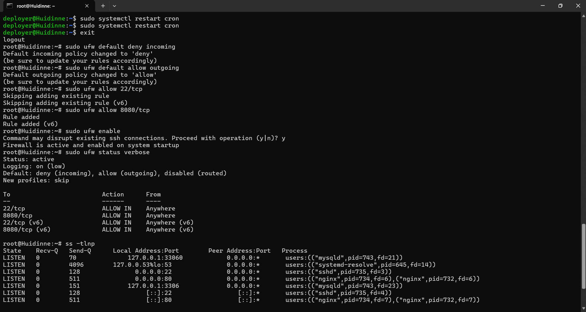

# Báo Cáo Bài Tập 3: Cấu hình tường lửa UFW và chẩn đoán cổng mạng
## 2. Các bước thực hiện

### Bước 1: Thiết lập chính sách mặc định (Default Policies)
Thiết lập chính sách chặn toàn bộ kết nối đi vào (deny incoming) và cho phép toàn bộ kết nối đi ra (allow outgoing):
```bash
sudo ufw default deny incoming
sudo ufw default allow outgoing
```

### Bước 2: Mở các cổng cần thiết
- Mở cổng 22 (SSH) để đảm bảo không bị mất quyền truy cập quản trị VPS:
```bash
sudo ufw allow 22/tcp
```
- Mở cổng 8080 (Web App service):
```bash
sudo ufw allow 8080/tcp
```

### Bước 3: Kích hoạt UFW
Bật tường lửa và xác nhận khi nhận được cảnh báo:
```bash
sudo ufw enable
```

---

## 3. Kết quả kiểm tra
